<p align="center">
  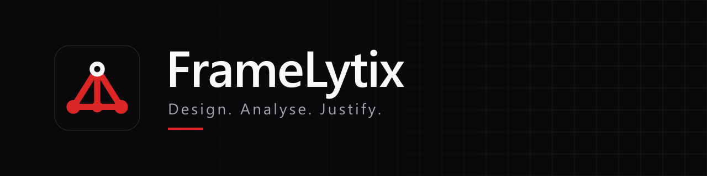
</p>

# FrameLytix

**Design. Analyse. Justify.**

FrameLytix is an offline-first desktop workspace that helps an engineering team keep a design decision connected to the requirements, calculations, drawings and evidence behind it. You record requirements, compare design alternatives with a weighted decision matrix (with pass/fail mandatory constraints kept separate from scoring), document calculations, link everything together, and export a design report. Everything is stored in a normal folder on your own computer. There are no accounts, no cloud services and no network use.

- **Platform:** Windows 10/11 x64 is the primary target. A macOS build is configured but has **not been built or tested**.
- **Status:** 0.1.0 pre-release.
- **Not certified engineering software.** It documents and supports decisions. It does not analyse structures or check codes. See [Disclaimer](#disclaimer).

---

## The problem

On a typical student or small-team design project, the information is scattered. Requirements live in a document, scoring is in a spreadsheet, calculations are in MATLAB or on paper, drawings are in a CAD folder, and the reasons for a decision are in someone's head or an email. When a requirement changes, nobody can easily answer: *Which decision depended on this? Which calculation supports it? Is the evidence recorded? Why did we choose option B?*

## How FrameLytix helps

FrameLytix gives that information one structure:

- **Structured reasoning.** Each design decision is an *engineering argument*: a problem statement, alternatives, weighted criteria, mandatory constraints, assumptions, a recorded selection and a justification.
- **Traceability.** Requirements, arguments, calculations, drawings/models, evidence and risks are linked. A traceability matrix shows at a glance which requirements have no supporting links.
- **Honest gaps.** Missing scores are never treated as zero. A design that fails a mandatory constraint is marked ineligible however well it scores. An unverified constraint makes a recommendation *provisional*. The review page lists what is still outstanding.
- **A portable result.** One folder you can copy, zip or put under Git, plus a PDF/HTML report.

## Screenshots

All screenshots are of the bundled, fictional sample project (a conceptual pedestrian truss bridge). Values are illustrative.

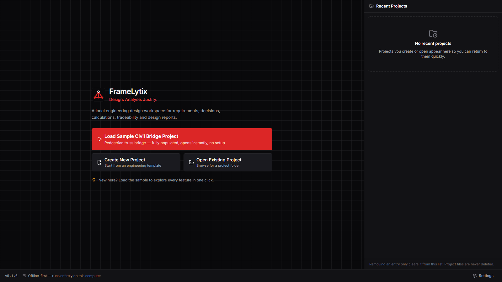
*Welcome screen. "Load Sample Civil Bridge Project" opens a temporary copy of the sample.*

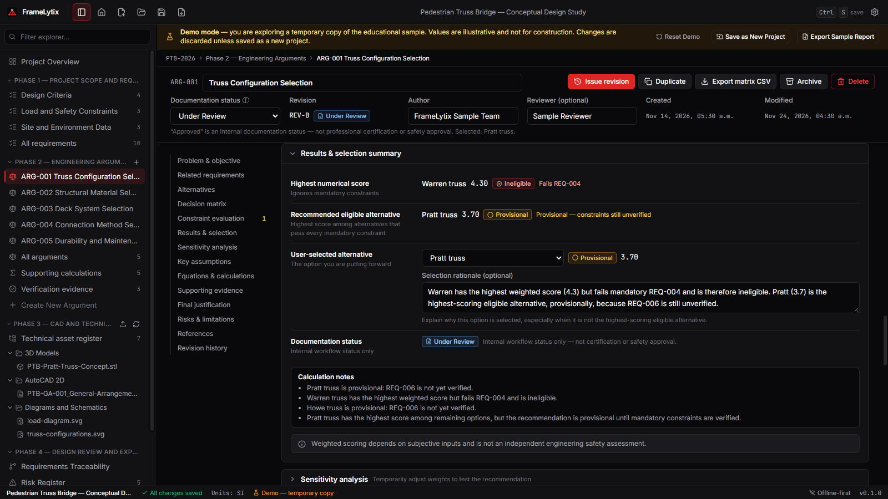
*Decision summary. The highest raw score is not automatically the recommendation.*

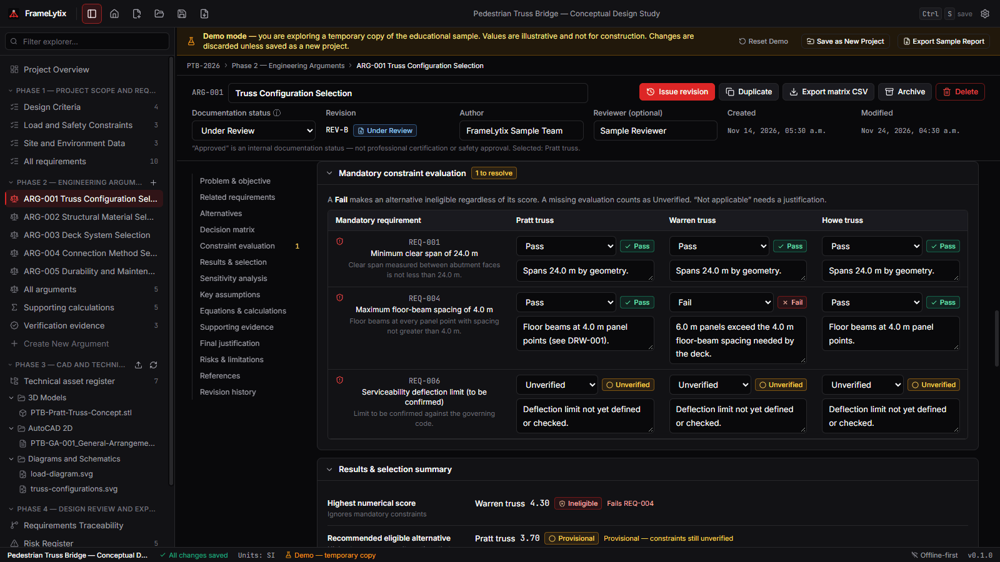
*Mandatory constraints are evaluated separately from scoring.*

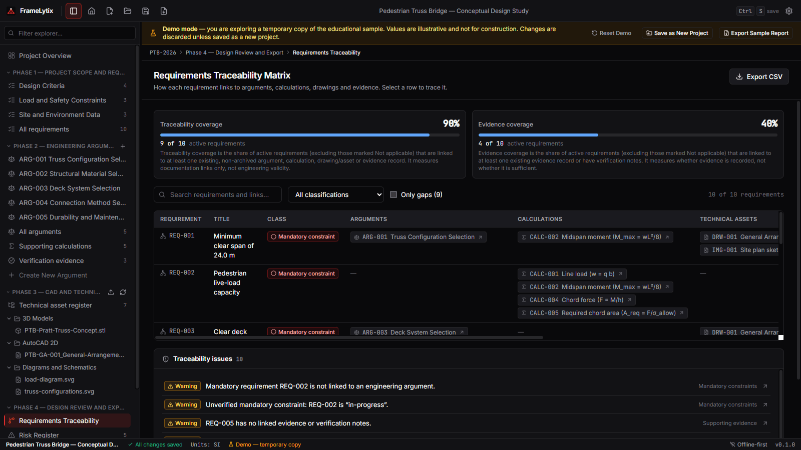
*Traceability matrix with coverage and issue list.*

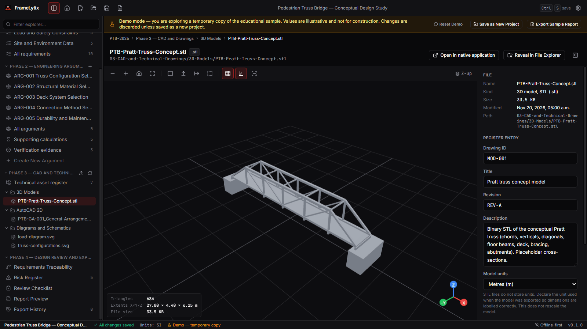
*Built-in STL viewer for 3D models.*

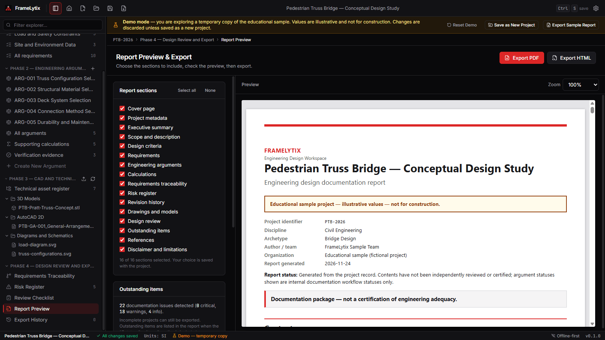
*Report preview and export (PDF or HTML).*

<details>
<summary>More screenshots</summary>

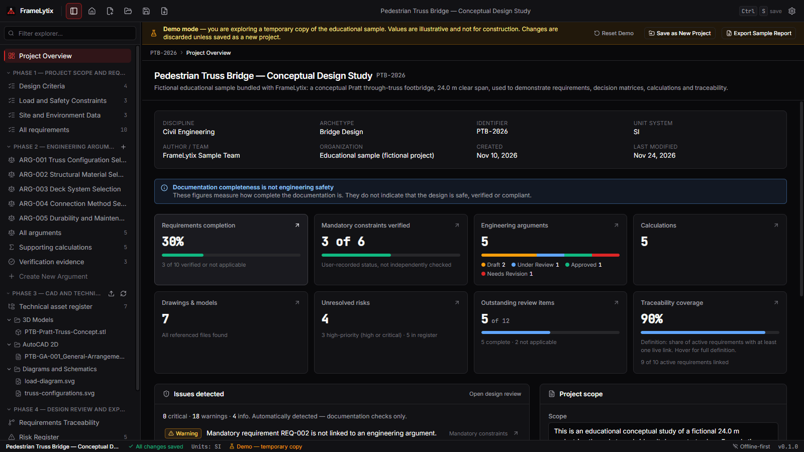
*Project overview.*

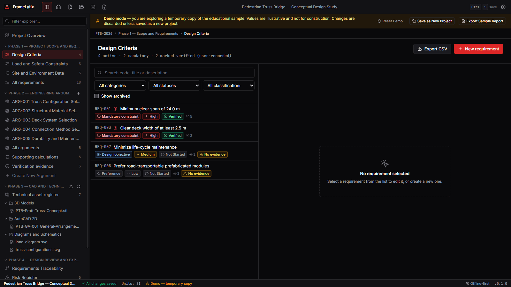
*Requirements.*

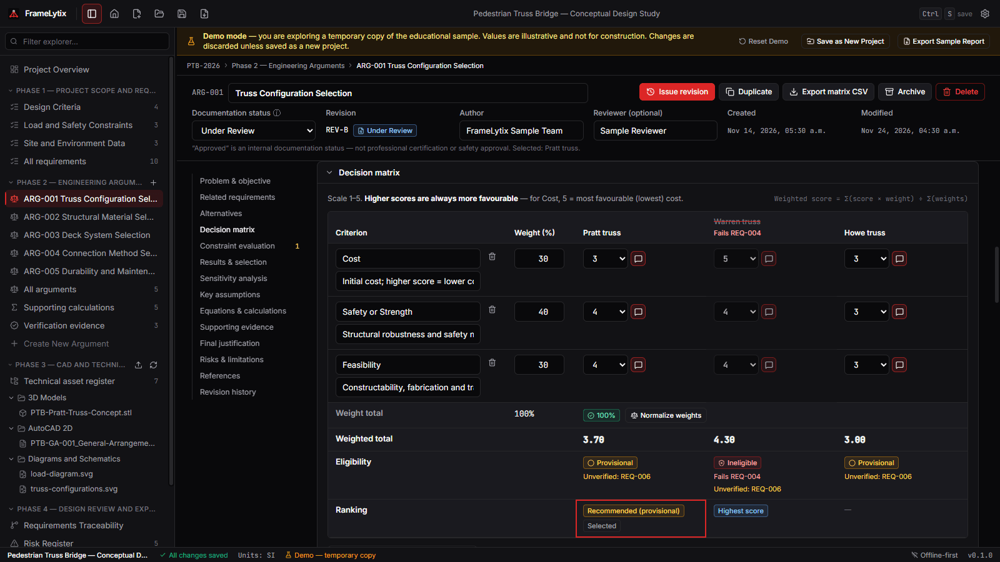
*Weighted decision matrix.*

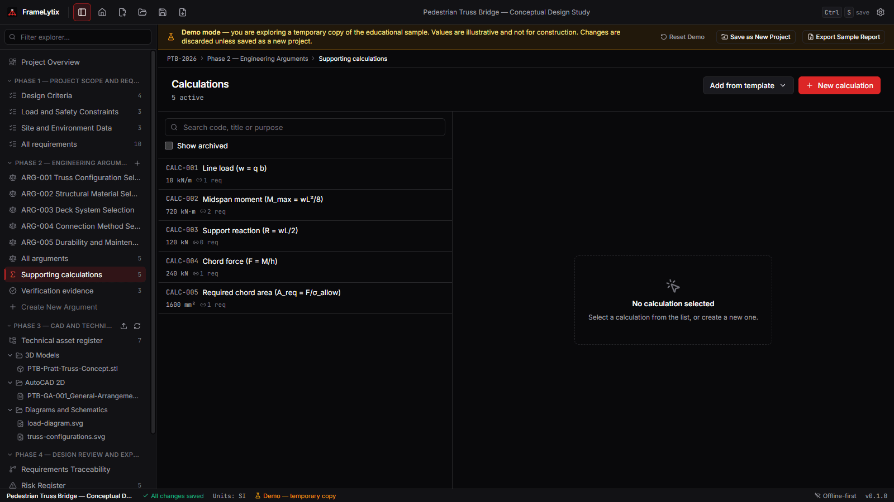
*Calculations.*

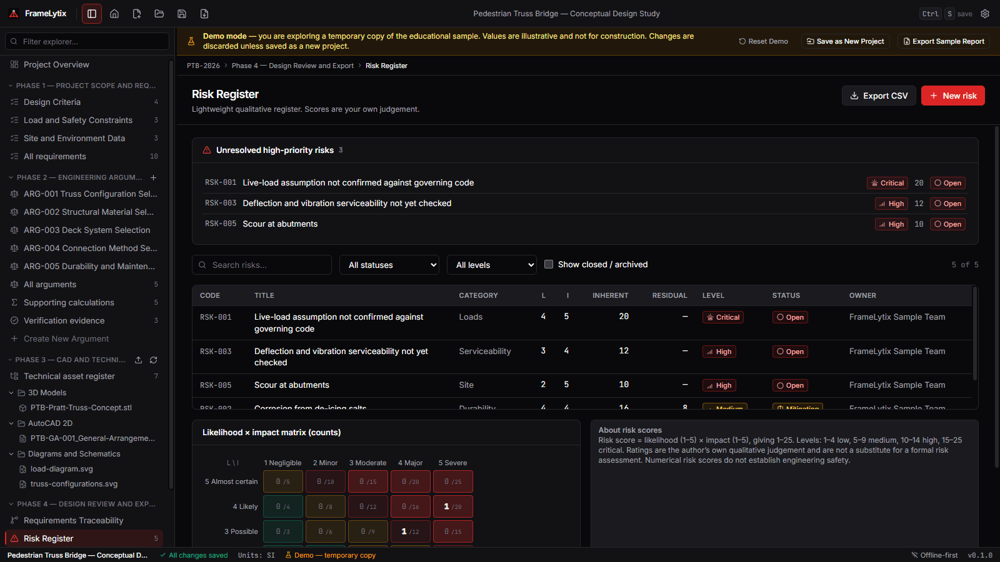
*Risk register.*

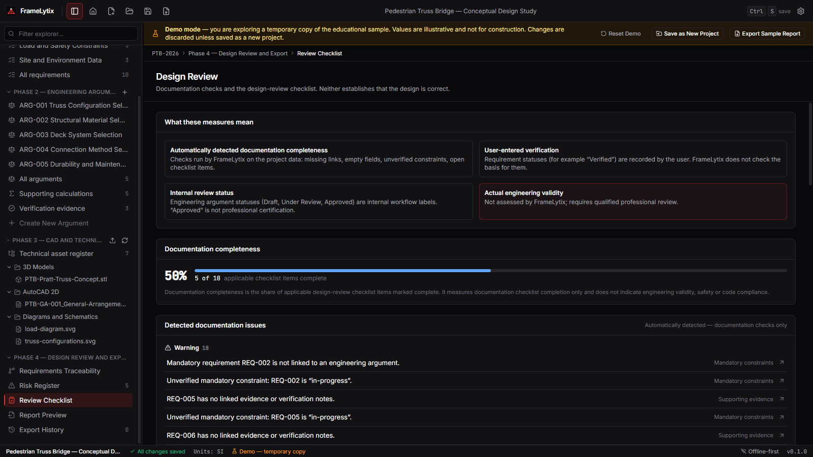
*Design review.*

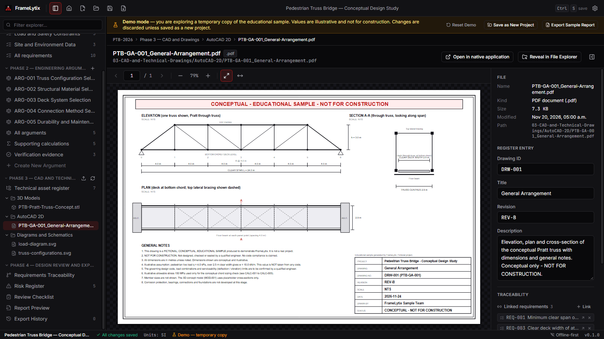
*PDF viewer.*

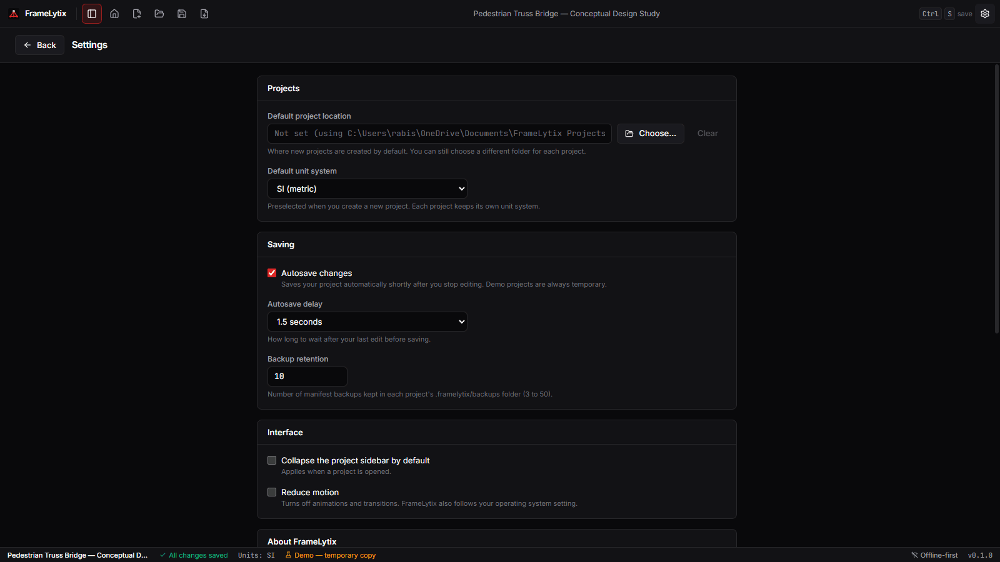
*Settings.*

</details>

## Download

> No release has been published yet. Until one is, run FrameLytix from source (see [Quick start from source](#quick-start-from-source)).

1. Open the project's **Releases** page: <https://github.com/rabihsaab-90/FrameLytix/releases>.
2. Download `FrameLytix-Setup-0.1.0-x64.exe` and the matching `.sha256` checksum file.
3. **Verify the checksum first.** In PowerShell, from the folder containing the download:

   ```powershell
   Get-FileHash -Algorithm SHA256 .\FrameLytix-Setup-0.1.0-x64.exe
   ```

   The value must match the one in the `.sha256` file exactly. If it does not, do not run the file.
4. **The installer is not code-signed.** Windows SmartScreen may show "Windows protected your PC". Only after the checksum matches, you can choose **More info → Run anyway**. Do not disable Windows security features to install FrameLytix.

No macOS download is offered because no macOS build has been produced or tested.

## Features

Everything below exists in the current code.

**Project setup**
- 21 project archetypes across Civil, Mechanical, Aerospace, Electrical and Custom disciplines (for example Bridge Design, Pressure Vessel, UAV Design, PCB Design, plus a generic and a user-defined type).
- A two-step wizard that creates a project folder with four phase folders and a starter set of requirements, suggested arguments, risks and review items.
- A bundled sample project (opens as a temporary copy; the original is never changed).

**Requirements**
- Classification (mandatory constraint, design objective, preference), priority, acceptance criterion, target value and unit, verification method, status and verification notes.
- Archive instead of delete; "not applicable" links with a written reason.

**Engineering arguments and decisions**
- Alternatives, weighted criteria (scores 1–5, higher is better), automatic weighted totals.
- Mandatory-constraint evaluation per alternative: Pass, Fail, Unverified, Not applicable (needs a justification).
- Eligibility (eligible / provisional / ineligible), recommendation, and a required rationale when the selection differs from the recommendation.
- Weight normalization and a temporary sensitivity analysis.
- Assumptions, justification, references, internal documentation status, revision history with restore.

**Calculations**
- LaTeX equations rendered with KaTeX, variables with units, an optional restricted expression evaluator (no code execution), manual or evaluated results, and a warning when a stored result is out of date.

**Drawings and models**
- Import files by picker or drag and drop (copy only, with collision choices).
- Built-in viewers for PDF, STL 3D models, PNG/JPEG/SVG images and plain text/CSV.
- Native CAD files (DWG, DXF, STEP, IGES, SolidWorks and others) open in whatever application is installed.
- A technical asset register with drawing IDs, revisions and missing-file detection.

**Traceability, risk and review**
- Undirected links between requirements, arguments, calculations, assets, evidence and risks.
- Traceability and evidence coverage, with an issue list that links back to the problem.
- Risk register (likelihood × impact, optional residual rating).
- Design review checklist with documentation-completeness measure.

**Reporting**
- 16 selectable report sections; export to PDF or HTML; CSV export of requirements, traceability matrix, risk register and each decision matrix.

**Data safety**
- Atomic saves, autosave, rolling backups, a project lock, external-change detection, recovery from a damaged manifest.

## Engineering workflow

1. **Requirements.** Capture what the design must do. Mark hard limits as *mandatory constraints*.
2. **Engineering arguments.** For each decision (for example "Truss configuration"), state the problem, list alternatives and link the related requirements.
3. **Mandatory constraints versus scoring.** Pass/fail constraints decide *eligibility*. Weighted scores rank only what is eligible.
4. **Weighted matrix.** Score each alternative from 1 to 5 against each criterion (higher is always better, including cost). The weighted score is:

   ```
   weighted score = Σ(score × weight) ÷ Σ(weight)
   ```

   Example from the sample (weights 30 / 40 / 30): Pratt 3, 4, 4 gives 3.70; Warren 5, 4, 4 gives 4.30; Howe 3, 3, 3 gives 3.00.
5. **Calculations.** Record the equation, inputs and result, and link them to the requirements and arguments they support.
6. **Traceability.** Check the matrix for requirements with no links or no evidence.
7. **Review and export.** Work through the checklist, review outstanding items, then export a report.

## Quick start from source

Requirements: Node.js 26 LTS (see `.nvmrc`) with npm, and Git.

```powershell
git clone https://github.com/rabihsaab-90/FrameLytix.git
cd FrameLytix
npm ci
npm run dev
```

`npm ci` installs the exact versions in `package-lock.json`. `npm run dev` starts the app with live reload.

## Build the installer

On Windows:

```powershell
npm run dist:win
```

The installer is written to `release/FrameLytix-Setup-0.1.0-x64.exe`. It is an unsigned NSIS installer (per-user, lets you choose the install folder). The build never publishes anything.

`npm run dist:mac` must be run on a Mac. It is configured but has never been run or tested.

## Architecture

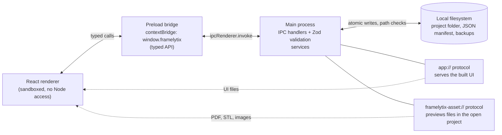

The renderer can only call the functions the preload bridge exposes. The main process checks who is calling, validates every argument, and is the only part that touches the disk. More detail: [docs/ARCHITECTURE.md](docs/ARCHITECTURE.md).

## Technology stack

- **Shell:** Electron 45, electron-vite, Vite.
- **UI:** React 19, TypeScript, Tailwind CSS 4, Zustand with Immer, lucide-react icons.
- **Data validation:** Zod.
- **Rendering:** KaTeX (equations), pdf.js (`pdfjs-dist`), three.js with React Three Fiber and drei (STL).
- **Fonts:** Inter and JetBrains Mono, bundled via Fontsource.
- **Packaging:** electron-builder (NSIS for Windows, DMG configured for macOS).
- **Quality tools:** Vitest, Playwright (Electron), ESLint, TypeScript.

## Offline-first design

- **Project data** lives in the project folder you choose: `framelytix-project.json`, your files, and a hidden `.framelytix/` folder (backups and a lock file).
- **App preferences** (settings, recent-projects list, a small log) live in the operating system's per-user app-data folder, outside any project.
- **No network.** The main process cancels any request from the app window to `http`, `https`, `ws`, `wss` or `ftp` addresses in the packaged app. Fonts, the PDF worker and equation rendering are bundled. See [docs/OFFLINE_VERIFICATION.md](docs/OFFLINE_VERIFICATION.md) for how to check this yourself.

## Development commands

| Command | What it does |
| --- | --- |
| `npm run dev` | Start the app in development mode with live reload |
| `npm run lint` | Run ESLint |
| `npm run typecheck` | Run the TypeScript compiler checks (main process and renderer) |
| `npm test` | Run unit and integration tests (Vitest) |
| `npm run test:e2e` | Build, then run Playwright end-to-end tests against the real Electron app |
| `npm run check` | Lint, typecheck, test and build in one go |
| `npm run build` | Build the app bundles (output in `out/`) |
| `npm run dist:win` | Build the Windows installer into `release/` |
| `npm run dist:mac` | Build the macOS DMG (must run on macOS; untested) |

## Testing

Automated tests are organised in three groups:

- **Unit** (`tests/unit`): pure logic such as the decision matrix, traceability, completeness, risk, expression parser, revisions, templates and the report builder.
- **Integration** (`tests/integration`): file handling against temporary folders (saving, locks, backups, imports, path containment, settings, demo copy).
- **End-to-end** (`tests/e2e`): Playwright drives the built Electron app, including assertions that no `http(s)` requests are made.

**Latest local results (Windows 11, Node 26.13.1, 2026-11-24):**

| Suite | Result |
|---|---|
| Unit + integration (`npm test`) | 375 passed, 0 failed (22 files) |
| End-to-end (`npm run test:e2e`) | 22 passed, 0 failed |
| Lint / typecheck | Clean |
| Windows installer (`npm run dist:win`) | Built; packaged app smoke-tested offline (sample, PDF, STL, KaTeX, fonts, no network requests) |

GitHub Actions workflows exist in `.github/workflows/` (CI on Windows and macOS, and a release workflow), but they have **never run** because the repository is not published yet. Treat CI as unverified until the first push.

## Limitations

- No built-in preview for DWG, DXF, STEP, IGES or SolidWorks files. They open in an external application if one is installed.
- STL files do not store units. You can declare a unit per model, but this only labels dimensions; it does not rescale the model.
- Installers are unsigned. macOS has not been built or tested.
- **Not certified engineering software.** No structural analysis, no code-compliance checking.
- No unit conversion. Enter values in consistent units.
- Revision history is a convenience record. It is **not tamper-proof**; anyone with access to the project file can edit it.
- Single-user, local application. There is no real-time collaboration; a lock file only warns against opening the same project twice.

## Contributing

See [CONTRIBUTING.md](CONTRIBUTING.md). Security issues: see [SECURITY.md](SECURITY.md).

## Licence

MIT © 2026 Rabih Saab. See [LICENSE](LICENSE). Bundled open-source components are listed in [THIRD_PARTY_NOTICES.md](THIRD_PARTY_NOTICES.md).

## Disclaimer

FrameLytix is an educational engineering documentation and decision-support workspace. It is not certified engineering design software, a structural analysis solver or a regulatory compliance engine. Documentation completeness, weighted scores and internal approval statuses do not establish that a design is safe, compliant or fit for construction. Responsibility for engineering validation remains with appropriately qualified individuals.

## AI-assisted development

FrameLytix was built with AI assistance. The author is an engineering student who defined the product's purpose, engineering logic and rules and directed and reviewed the work; the source code was largely written by an AI coding assistant. Automated tests and the documentation describe what the code actually does, but the project has not had an independent professional code or security review.
