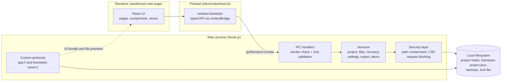

# FrameLytix Architecture

This page explains how FrameLytix is put together, for readers with limited software background. File names are given so you can check any statement against the code.

## The big idea: three boundaries

An Electron app is really two programs working together:

1. The **renderer** is the window you see: the user interface, built with React. It runs inside a locked-down web page with **no** direct access to your files or the operating system.
2. The **main process** is a Node.js program running in the background. It is the only part allowed to read and write files, show file dialogs, and talk to Windows.
3. The **preload bridge** is a very small script that connects the two. It exposes a short list of named functions (`window.framelytix`) and nothing else.

Think of the renderer as a customer, the main process as a bank teller, and the preload as the glass window with a fixed set of forms. The customer can only submit forms from the list, and the teller checks every form.



## Data model: one source of truth

The project data model is a single Zod schema, `shared/schemas/project.ts`. The same schema is used by the main process (to validate what is read and written), the renderer (types), and the report builder. Pure business logic (decision matrix scoring, traceability coverage, completeness, risk scoring, revisions, expression parser) lives in `shared/utilities/` as plain functions without any Electron or React code, so it can be unit-tested easily.

Derived values such as weighted scores and coverage percentages are **never stored**; they are recomputed from the data when needed.

## Data flow

### Open

1. The user picks a project (or the sample). The renderer calls `window.framelytix.project.openDialog()` (or `openRecent`).
2. The main process shows the folder dialog, finds `framelytix-project.json`, reads the bytes and records their **SHA-256 hash**.
3. The JSON is parsed and validated with `parseManifest`. A damaged file returns a recoverable error plus a list of backups; a *newer* `schemaVersion` is rejected without touching the file.
4. The main process acquires the **lock** (`.framelytix/lock.json`), checks which referenced asset files are missing (warnings), and stores the session. The *main process* now owns the "current project root". The renderer receives the manifest and display information only.

### Edit and autosave

- The renderer keeps the manifest in a Zustand store with Immer (`src/stores/projectStore.ts`). Edits update the in-memory copy and mark it *dirty*.
- After a pause (default 1.5 seconds, configurable) the store sends the whole manifest to `project.save` with `manual: false`.

### Save

Implemented in `electron/services/projectService.ts` (`doSave`):

1. **Serialised.** All saves for a session go through one queue (`SerialQueue` in `fsUtils.ts`), so two saves can never interleave.
2. **Validated.** The incoming manifest is re-validated with the full schema. It must belong to the same project ID as the open session.
3. **Conflict detection.** The file on disk is hashed and compared with the hash FrameLytix last read or wrote. If they differ, someone else changed the file; the save returns `conflict` and the user chooses to reload or to overwrite (in which case the outside version is first saved as `external-<time>.json`).
4. **Backup.** Before replacing a changed file, the old bytes are copied into `.framelytix/backups/` (always for a manual save; at most every 5 minutes for autosave). Old backups are pruned to the retention setting.
5. **Atomic write.** The new JSON is written to `framelytix-project.json.tmp`, flushed to disk (`fsync`), then renamed over the real file (`writeFileAtomic`). On Windows, a rename can briefly fail if antivirus or a sync client holds the file, so it retries up to five times with short delays. A reader therefore sees either the old complete file or the new complete file, never half of one.
6. The new hash is remembered for the next conflict check.

A **file watcher** (`createProjectWatcher` in `fileService.ts`) also watches the project folder. If the manifest changes outside the app, the renderer is told right away and shows the conflict banner; other file changes refresh the explorer.

### Close

Closing the window with unsaved changes asks the renderer first. On close the queue is drained, then the lock file is released (only if it still belongs to this app instance).

## IPC contract and validation

- **The contract** is `shared/types/ipc.ts`: the list of channel names (`IPC_CHANNELS`), the payload types, and the `FramelytixApi` interface exposed as `window.framelytix`. Changes start there.
- **The bridge** (`electron/preload.ts`) implements each method as a thin `ipcRenderer.invoke` call. Push events from the main process are wrapped so the raw IPC event object never reaches page code. `contextBridge.exposeInMainWorld` is used; `ipcRenderer` itself is not exposed.
- **Every handler** is registered through `handle()` in `electron/ipc/handle.ts`, which:
  1. accepts the call only if it comes from the app's main window, from its top-level frame, loaded from the app's own origin (`isTrustedSender`);
  2. validates the argument list against a Zod schema and rejects anything that does not match;
  3. turns unexpected errors into a generic message for the renderer while writing details to a local log.
- At startup, `assertAllChannelsRegistered()` fails if any declared channel has no handler, and registering a channel twice throws.

Handlers are grouped in `electron/ipc/`: `appIpc`, `settingsIpc`, `projectIpc`, `filesIpc`, `exportIpc`.

## Security boundaries

| Control | Where |
| --- | --- |
| `contextIsolation: true`, `nodeIntegration: false`, `sandbox: true`, `webSecurity: true` for the main window; devtools only when not packaged | `electron/windows/mainWindow.ts` |
| Preload exposes only the typed API | `electron/preload.ts` |
| Sender-frame check and Zod argument validation on every IPC call | `electron/ipc/handle.ts` |
| Single running instance | `electron/main.ts` |
| New windows denied; navigation allowed only to the app's own URL; `<webview>` blocked; all permission requests denied | `electron/security/hardening.ts` |
| Network requests (`http`, `https`, `ws`, `wss`, `ftp`) cancelled (only the dev server is allowed in development); `file:` requests cancelled except for the hidden PDF window | `electron/security/hardening.ts` (`onBeforeRequest`) |
| Content Security Policy: scripts only from the app itself, no `eval`, `object-src 'none'`, `form-action 'none'`; sent as a header by the `app://` protocol and also injected into the built `index.html` | `electron/security/csp.ts`, `electron.vite.config.ts` |
| Path containment: absolute paths, drive letters, UNC/device paths, `..`, NUL bytes and NTFS alternate data streams rejected; the deepest existing parent is resolved with `realpath`, so symlinks and junctions that lead outside the project are refused | `electron/security/paths.ts` (`resolveInsideRoot`) |
| The renderer sends only project-relative paths; the main process owns the project root | `shared/types/ipc.ts`, `electron/appState.ts` |
| Blocked file types (executables, scripts, shortcuts, disk images) cannot be imported or opened | `electron/security/paths.ts` (`BLOCKED_EXTENSIONS`), `fileService.ts`, `filesIpc.ts` |
| Native files are opened with `shell.openPath` (hands the file to the associated app; no command line is built) | `electron/ipc/filesIpc.ts` |
| Export open/reveal acts only on files exported in this session | `electron/services/exportService.ts` (`ExportTracker`) |
| Equations: KaTeX with `trust: false`; no `dangerouslySetInnerHTML` for user content | `src/components/calculations/Equation.tsx` |
| Report preview in an iframe with an empty `sandbox` attribute | `src/pages/ReportPage.tsx` |
| CSV exports guard against spreadsheet formula injection; HTML output is escaped | `shared/utilities/csv.ts`, `html.ts` |
| Restricted expression evaluator (own parser, no `eval` or `new Function`) | `shared/utilities/expression.ts` |

For the project's security policy and how to report problems, see `SECURITY.md`.

## Custom protocols

Two custom URL schemes are registered in `electron/security/protocols.ts`.

- **`app://framelytix/...`** serves the built user interface from `out/renderer` only. Requests that resolve outside that folder return "Not found". Responses carry the production CSP header. Serving the UI this way (instead of `file://`) lets `file:` requests be blocked everywhere else.
- **`framelytix-asset://project/<relative path>`** serves *preview* files from the **currently open project only**, for the viewers. It allows only GET and HEAD, only a fixed list of types (PNG, JPEG, SVG, PDF, STL, TXT, CSV), re-checks path containment on every request, supports byte ranges, disables caching, and sends a CSP that stops an opened SVG from running script. Cross-origin access is permitted only for the app's own origin.

## Report pipeline

Implemented in `shared/report/buildReport.ts` (pure), `electron/ipc/exportIpc.ts`, `electron/services/exportService.ts` and `electron/windows/pdfExport.ts`.

1. The renderer sends the current manifest and the chosen section list. The main process **re-validates** both with Zod.
2. The report builder turns them into one self-contained HTML string. Equations use KaTeX's MathML output, so no external stylesheet or font is needed. PNG/JPEG/SVG assets (up to 40 images of 5 MB or less, from inside the project) are embedded as data URIs.
3. **Preview**: the HTML is shown in a sandboxed iframe.
4. **HTML export**: written atomically to the chosen file.
5. **PDF export**: the HTML is written to a temporary file and loaded in a hidden browser window with JavaScript **disabled**, sandboxing on and only that window allowed to load a `file:` URL. Electron's `printToPDF` renders US Letter with margins and a "title — Page X of Y" footer. The result is checked to start with `%PDF`, then written. The temporary file and window are always cleaned up, and there is a 60-second time limit.

## Demo mode

The "sample project" is never opened in place. `electron/services/demoService.ts` copies the bundled `samples/pedestrian-truss-bridge` folder (excluding lock files, backups and symlinks) into a new folder `FrameLytix-Demo/<random-uuid>/Pedestrian-Truss-Bridge` in the operating system's temporary directory, and opens that copy with `isDemo: true`. **Reset Demo** deletes the copy and makes a fresh one. **Save as New Project** copies it to a location you choose, with a new project ID and `isSample: false`. Leftover demo copies from earlier runs are removed at startup. A test checks that the bundled sample is unchanged after use.

## Where state lives

| What | Where |
| --- | --- |
| Project data | `framelytix-project.json` in the project folder |
| Backups, lock | `.framelytix/` in the project folder |
| App settings, recent-projects list | `settings.json` in Electron's per-user app-data folder (`SettingsService`); a damaged file is preserved and defaults are used |
| Error log | `logs/` in the same app-data folder |
| Demo copy, export scratch files | The OS temporary folder |

## Repository layout

```
electron/            main process
  main.ts            startup; wires everything together
  preload.ts         the bridge
  ipc/               IPC handlers (validated)
  services/          file logic in plain Node (project, files, recovery, settings, export, demo)
  security/          path rules, CSP, request blocking, protocols
  windows/           main window and the PDF export window
shared/              code used by both sides
  schemas/           Zod data model (project, settings)
  types/ipc.ts       the IPC contract
  utilities/         pure logic (decisionMatrix, traceability, completeness, risk, expression, revisions...)
  report/            HTML report builder
src/                 React renderer
  pages/ components/ stores/ hooks/ lib/ styles/
  templates/         the 21 project archetypes (pure data)
  config/branding.ts names, version, disclaimer
samples/             bundled sample project
scripts/             asset and icon generation, notices generation
tests/               unit, integration, e2e
docs/                documentation, screenshots, branding
.github/workflows/   CI and release workflows (not yet run)
```

The services in `electron/services/` deliberately do not import `electron`, so they can be tested against temporary folders with ordinary Vitest.

## Testing strategy

- **Unit tests** (`tests/unit`, Vitest): the pure logic, the sample project's integrity, templates, escaping, the report builder, the STL parser and a few React components.
- **Integration tests** (`tests/integration`): the file services on real temporary folders: saving and conflicts, backups and recovery, locks, imports, path containment, settings, the demo copy and exports.
- **End-to-end tests** (`tests/e2e`, Playwright): launch the built Electron app with an isolated settings folder and drive the real UI (`demo-workflow.spec.ts`, `project-lifecycle.spec.ts`), including assertions that no `http(s)` request is made.
- **Rules:** tests use fixtures and temp folders only, never real user projects.
- **CI:** `.github/workflows/ci.yml` runs lint, typecheck, tests and build on Windows and macOS, and the e2e tests on Windows. These workflows exist but have **not run** yet because the repository has not been published.
