# FrameLytix User Guide

This guide is for people who are not programmers. It walks through FrameLytix 0.1.0 step by step, using the built-in sample project so you can follow along. Button and menu names are written the way they appear in the app.

> FrameLytix is a documentation and decision-support tool. It is **not** certified engineering software. A green tick, a high score or an "Approved" status inside FrameLytix does not mean a design is safe or compliant.

## Contents

1. [Installing](#1-installing)
2. [Opening the sample project](#2-opening-the-sample-project)
3. [Finding your way around](#3-finding-your-way-around)
4. [Creating a project](#4-creating-a-project)
5. [Editing requirements](#5-editing-requirements)
6. [Creating an engineering argument](#6-creating-an-engineering-argument)
7. [Mandatory constraints](#7-mandatory-constraints)
8. [Weighted decision matrices](#8-weighted-decision-matrices)
9. [Recording calculations](#9-recording-calculations)
10. [Importing drawings and files](#10-importing-drawings-and-files)
11. [Viewing PDFs, 3D models and images](#11-viewing-pdfs-3d-models-and-images)
12. [Opening native CAD files](#12-opening-native-cad-files)
13. [Linking evidence](#13-linking-evidence)
14. [Risk register](#14-risk-register)
15. [Reviewing the project](#15-reviewing-the-project)
16. [Exporting reports](#16-exporting-reports)
17. [Saving and backups](#17-saving-and-backups)
18. [Moving a project to another computer](#18-moving-a-project-to-another-computer)
19. [Using Git with a project](#19-using-git-with-a-project-optional)
20. [Keyboard shortcuts](#20-keyboard-shortcuts)
21. [Troubleshooting](#21-troubleshooting)

---

## 1. Installing

1. Download `FrameLytix-Setup-0.1.0-x64.exe` and its `.sha256` file from the project's GitHub Releases page.
2. **Check the download.** Open PowerShell in the folder where you saved it and run:

   ```powershell
   Get-FileHash -Algorithm SHA256 .\FrameLytix-Setup-0.1.0-x64.exe
   ```

   Compare the result with the text in the `.sha256` file. They must match. If they do not, delete the file and do not run it.
3. Double-click the installer. **The installer is not code-signed**, so Windows SmartScreen may say "Windows protected your PC". If (and only if) the checksum matched, select **More info**, then **Run anyway**. Do not turn off Windows security to get past this.
4. The installer lets you choose the install folder and creates a desktop shortcut. It installs for your user account only.

FrameLytix is built for Windows 10/11 (64-bit). A macOS version is configured but has not been built or tested.

## 2. Opening the sample project

The easiest way to learn FrameLytix is the sample.

1. Start FrameLytix. On the welcome screen, select **Load Sample Civil Bridge Project**.

   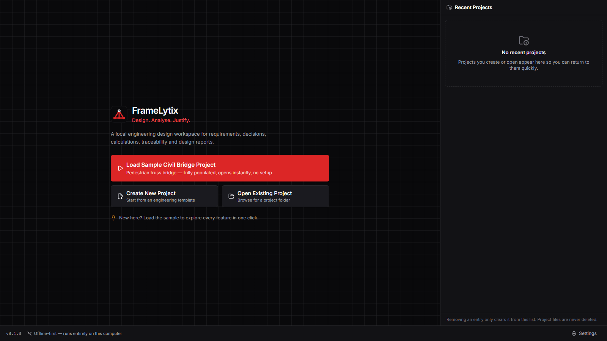

2. An amber **Demo mode** banner appears. You are working on a *temporary copy*. The original sample is never changed, and changes are discarded unless you select **Save as New Project** in the banner. **Reset Demo** throws away your edits and starts again.

The sample is a fictional conceptual 24 m pedestrian truss bridge. All numbers are illustrative; it is not a real design.

## 3. Finding your way around

The left-hand **project explorer** is organised in four phases:

| Phase | What is in it |
| --- | --- |
| Phase 1 – Project Scope and Requirements | Requirements in three groups (the group names depend on the project type; the defaults are *Design Criteria*, *Load and Safety Constraints*, *Site and Environment Data*) and **All requirements** |
| Phase 2 – Engineering Arguments | Each argument, **All arguments**, **Supporting calculations**, **Verification evidence**, and **Create New Argument** |
| Phase 3 – CAD and Technical Drawings | **Technical asset register** and the real folders on disk (import and refresh buttons) |
| Phase 4 – Design Review and Export | **Requirements Traceability**, **Risk Register**, **Review Checklist**, **Report Preview**, **Export History** |

**Project Overview** sits above Phase 1. The **Filter explorer…** box narrows the list. The toolbar at the top has: toggle sidebar, Home, New project, Open project, Save, Export report and Settings. The status bar at the bottom shows the save state ("All changes saved"), the unit system and whether you are in a demo.

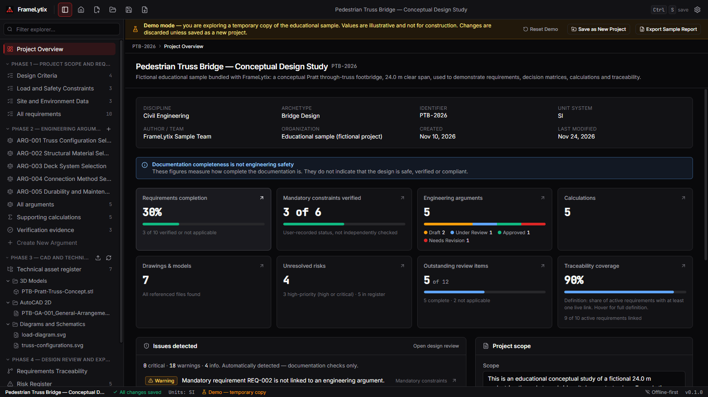

## 4. Creating a project

Select **Create New Project** on the welcome screen (or press Ctrl+N). The **New Project** wizard has two steps. Nothing is created until you select **Create Project**.

**Step 1 – Discipline.** Choose Civil, Mechanical, Aerospace, Electrical or Custom.

**Step 2 – Project type and details.**
- Pick the *project type* (archetype), for example "Bridge Design" or "Pressure Vessel". The **Custom Discipline** has a "User-defined Project Type" where you name your own.
- Enter a **title** and **author or team name** (both required). Optionally add a description and organization.
- The short **identifier** (for example `PTB-2026`) is suggested from the title; you can edit it.
- Choose the **unit system** (SI or Imperial). This is a label for your project; FrameLytix does not convert units.
- Choose the **parent folder** and confirm the **folder name**. FrameLytix checks that the new folder does not already exist.
- A checkbox lets you create a `.gitignore` file (useful only if you use Git; see [section 19](#19-using-git-with-a-project-optional)).

**What gets created.** A new folder with this layout:

```
My-Project/
  framelytix-project.json        <- all project data
  .gitignore                     <- only if you left that option on
  .framelytix/backups/           <- automatic backups (hidden metadata)
  01-Scope-and-Requirements/
  02-Engineering-Arguments/
  03-CAD-and-Technical-Drawings/
  04-Design-Review-and-Export/
```

Each phase folder also gets sub-folders suited to the project type. The project starts with template requirements, suggested arguments, risks and a review checklist. These are prompts to edit, not finished content. If creation fails part-way, FrameLytix removes the empty folder it made so nothing is left behind.

## 5. Editing requirements

Open **All requirements** (or one of the three groups). Select a requirement to edit it.

**Classification** says how strictly the requirement applies:

| Classification | Meaning |
| --- | --- |
| **Mandatory constraint** | Must be satisfied. An alternative that fails it is *ineligible* regardless of its score. |
| **Design objective** | Should be achieved as well as practical. |
| **Preference** | Desirable but optional. |

Other fields: priority (High, Medium, Low), acceptance criterion, target value and unit, source, verification method (calculation, inspection, analysis, physical test, simulation, document review, other), and notes.

**Status** can be Not Started, In Progress, Verified, Needs Revision or Not Applicable.

**Verified needs recorded evidence.** FrameLytix never verifies anything automatically; "Verified" only reflects what *you* record. Fill in **Verification notes** (how it was verified) and/or link a verification evidence record ([section 13](#13-linking-evidence)). If a requirement is marked Verified with neither, the editor shows "Marked Verified but verification evidence is missing" and the review page lists it as a critical issue.

You can **Duplicate**, **Archive** (hides it from counts and matrices, reversible) or delete a requirement.

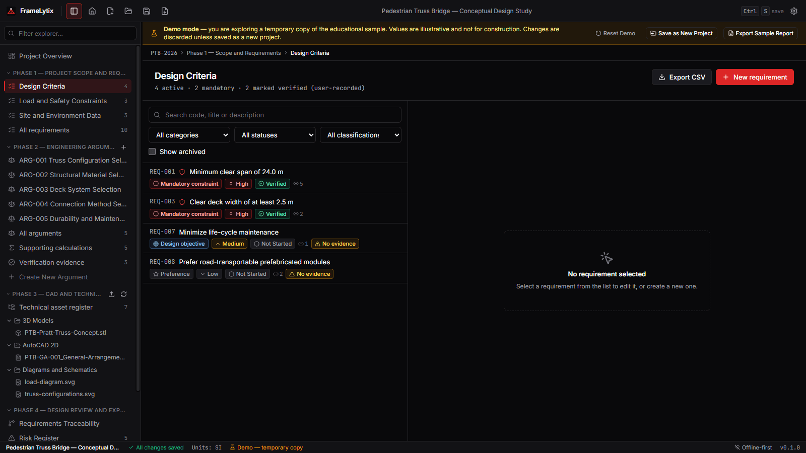

## 6. Creating an engineering argument

An *engineering argument* is the record of one design decision.

1. In the explorer, select the **+** next to the Phase 2 heading, or **Create New Argument**.
2. Give it a title. The argument page has collapsible sections, listed in the side navigation: Problem statement and design objective, Related requirements, Alternatives, Decision matrix, Mandatory constraint evaluation, Results and selection summary, Sensitivity analysis, Key assumptions, Equations and calculations, Supporting evidence, Final engineering justification, Risks and limitations, References, Revision history.
3. Write the **problem statement** and **objective**.
4. Under **Related requirements**, link the requirements this decision must respect. Linking the *mandatory* ones is what makes them show up in the constraint table.
5. Under **Alternatives**, select **Add alternative** for each option (aim for at least two).
6. Score the alternatives in the decision matrix ([section 8](#8-weighted-decision-matrices)), evaluate the constraints ([section 7](#7-mandatory-constraints)), then choose the **User-selected alternative** in the results summary.
7. List **Key assumptions** and write the **Final engineering justification**.

The **Documentation status** (Draft, Under Review, Approved, Needs Revision) is an internal workflow label only. "Approved" is **not** professional approval. If you materially edit an Approved argument (title, alternatives, matrix, constraint results, assumptions, selection, justification and so on), FrameLytix automatically returns it to Under Review.

**Issue revision** records a snapshot of the argument and moves it from REV-A to REV-B, and so on. You can **Restore** an earlier revision; the current state is recorded first, so history is never removed. The history is a convenience, not a tamper-proof audit trail.

## 7. Mandatory constraints

Mandatory constraints are kept **separate from scoring** on purpose. A cheap, strong design that breaks a hard limit should not win on points.

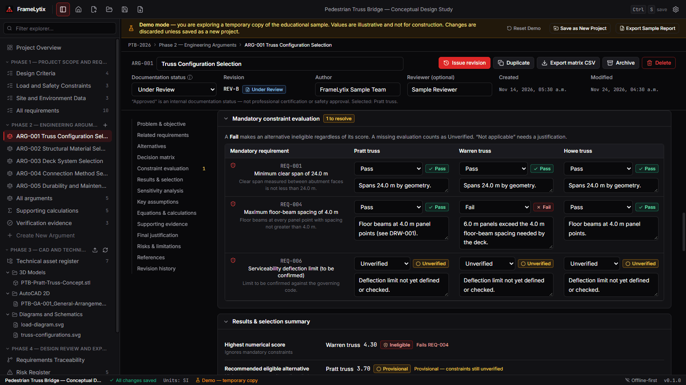

For each alternative and each linked mandatory requirement, choose a result:

| Result | Effect |
| --- | --- |
| **Pass** | The alternative meets it. |
| **Fail** | The alternative is **ineligible**, whatever its score. |
| **Unverified** | Not yet checked. The alternative is **provisional**. A missing evaluation counts as Unverified. |
| **Not applicable** | Needs a written justification; without one it is treated as Unverified. |

Write a short justification for each. In the sample, the Warren truss fails REQ-004 (floor-beam spacing) so it is ineligible even though it has the highest score. The Pratt truss passes the others but REQ-006 is not yet verified, so it is the *recommended, provisional* option.

## 8. Weighted decision matrices

Open the **Decision matrix** section of an argument.

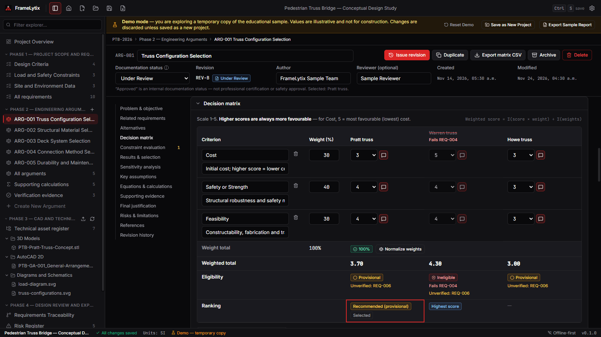

- **Scores are 1 to 5, and higher is always better.** This includes cost: a score of 5 on Cost means the *lowest* cost.
- Each criterion has a **weight** (percent). Weights should total 100%. The app shows the total, and **Normalize weights** rescales them to exactly 100 if they do not. If the total is not 100, scores are still calculated as Σ(score × weight) ÷ Σ(weight) and a notice appears. Negative weights or an all-zero total are errors and no score is shown.
- **A missing score is never treated as 0.** An alternative with any unscored criterion is marked incomplete and shows no weighted total.
- The weighted total, eligibility and ranking are calculated automatically. The recommendation is the highest-scoring *eligible* alternative; if none is eligible but some are provisional, the best provisional one is recommended and labelled provisional.
- If you select an alternative that is not the recommendation, a **selection rationale** is required.

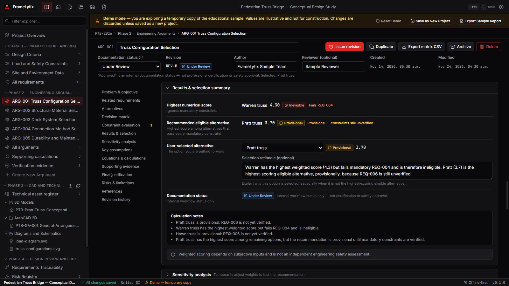

**Sensitivity analysis** (a collapsed section) lets you change the weights temporarily to see whether the recommendation changes. These changes are **not saved** unless you choose to apply them (after a confirmation, because applying is a material change).

You can export a matrix as CSV with **Export matrix CSV**.

## 9. Recording calculations

Open **Supporting calculations** and add a calculation. Fields:

- **Title** and **Purpose**.
- **Equation (LaTeX)** is displayed, nicely typeset. Examples: `M = \frac{wL^2}{8}`, `\sigma = \frac{F}{A}`. If the equation shows as an error, check for a missing brace `}` or backslash.
- **Variables**: symbol, description, value and unit. Use plain numbers for values (for example `10` or `1.5e3`).
- **Expression** (optional): restricted arithmetic using your variable symbols, such as `w*L^2/8`. Allowed: `+ - * / ^`, parentheses, numbers, your variables, the constants `pi` and `e`, and the functions `sqrt, abs, sin, cos, tan, asin, acos, atan, ln, log10, exp, min, max, round`. Nothing else runs; this is not a programming language. Trigonometric functions use radians.
- Select **Evaluate** to compute the result. The result is labelled "Evaluated (restricted parser, no unit conversion)". If you type a result by hand it is labelled "Manually entered". If you later change the variables, a warning says "Result is out of date – re-evaluate".
- **Method, Assumptions, Reference, Verification notes, Revision, Author.**
- **Traceability**: link the requirements, arguments and supporting files (MATLAB, CSV, PDF) the calculation relates to.

**There is no unit conversion.** The unit fields are just text. Enter all values in consistent units (for example metres and kilonewtons) yourself.

MATLAB `.m` files can be imported as supporting files. FrameLytix stores them and opens them in your editor but never runs them.

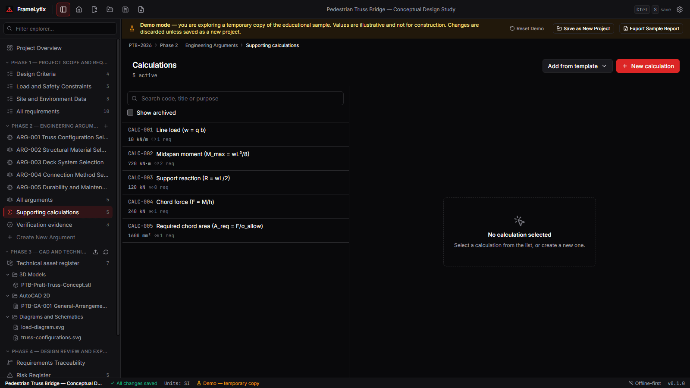

## 10. Importing drawings and files

1. In Phase 3, select the **Import files** icon, or the upload icon on a folder, or drag files onto the app.
2. FrameLytix shows an **Import files into project** list with the destination folder and a status for each file:
   - **New**: will be copied.
   - **Name exists** (collision): choose **Skip**, **Keep both (rename automatically)** or **Replace existing**. Replacing needs an extra confirmation tick.
   - **Identical**: the same file is already there. By default it is skipped.
   - **Rejected**: programs and scripts that could run code (for example `.exe`, `.bat`, `.ps1`, `.js`, `.lnk`) are never imported. Shortcuts, folders and files over 2 GB are also refused.
3. Select **Import N files**. Files are *copied*; your originals are not touched.

Each imported file gets an entry in the **Technical asset register** where you can set a drawing ID (for example `DRW-001`), title, description and revision. To use another folder, start the import from that folder in the explorer. Use the new-folder icon to create sub-folders.

## 11. Viewing PDFs, 3D models and images

Select a file in the Phase 3 tree.

- **PDF**: page navigation, zoom, fit page, fit width. Shortcuts: Page Up/Page Down, + / −, 0.
- **STL 3D model**: drag to orbit, buttons for zoom, reset, fit, Front/Top/Right/Isometric views, grid, axis indicator and wireframe (keys: + − 0 F G W). If your computer cannot do WebGL, a message appears instead; use **Open in native application**.
- **Images (PNG, JPEG, SVG)**: zoom, fit, actual size.
- **Text and CSV** files show as text.

**STL files do not contain units.** The viewer shows dimensions in "model units" unless you declare a unit for that model in the details panel (**Model units**). Declaring a unit only changes the label; it does not rescale the model.

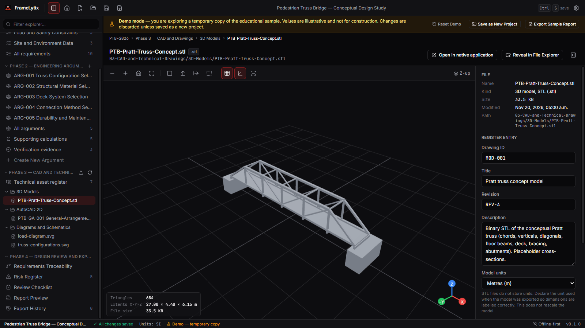
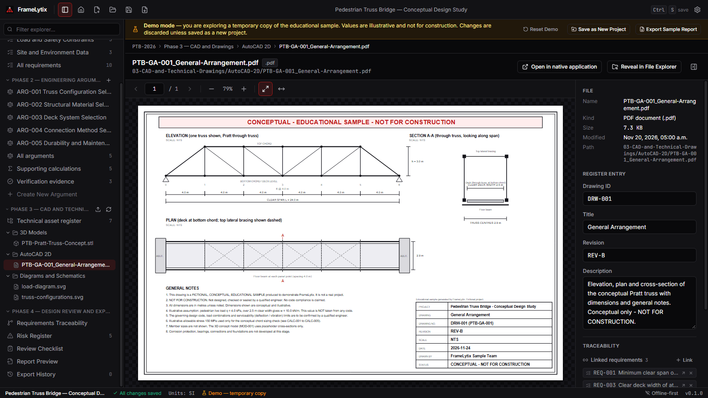

## 12. Opening native CAD files

FrameLytix cannot preview DWG, DXF, STEP, IGES, SolidWorks and similar files. Select the file, then **Open in native application**. FrameLytix hands the file to whatever program Windows has registered for it. If none is installed you will see "No application is associated with .dwg files on this computer"; install a suitable program (for DWG, examples are AutoCAD, DWG TrueView or FreeCAD) or use **Reveal in File Explorer**.

## 13. Linking evidence

Links are how FrameLytix connects things. A link between two records works in both directions: linking a requirement to a calculation shows up on both pages.

- On any record, find the **Link** area (for example "Linked requirements" on an argument). Choose a record from the drop-down to link it, or use the remove icon to unlink.
- **Verification evidence** records (Phase 2) capture how something was checked: a title, method, summary, outcome (Supports, Inconclusive, Does not support), who recorded it and when. Link them to requirements, arguments and so on.
- On a requirement that does not need an argument, calculation or drawing, you can record a short reason ("not applicable") instead.
- A warning appears if a link points to an archived or deleted record, or to a file that is missing on disk.

## 14. Risk register

Open **Risk Register**. Each risk has a title, description, category, owner, status (Open, Mitigating, Accepted, Closed), mitigation and notes.

**Risk score = likelihood (1 to 5) × impact (1 to 5)**, giving 1 to 25: 1–4 low, 5–9 medium, 10–14 high, 15–25 critical. You may also enter *residual* ratings after mitigation; if both are set, the residual score is the one used. Open or Mitigating risks rated high or critical are flagged on the review page. The ratings are your own judgement and not a formal risk assessment.

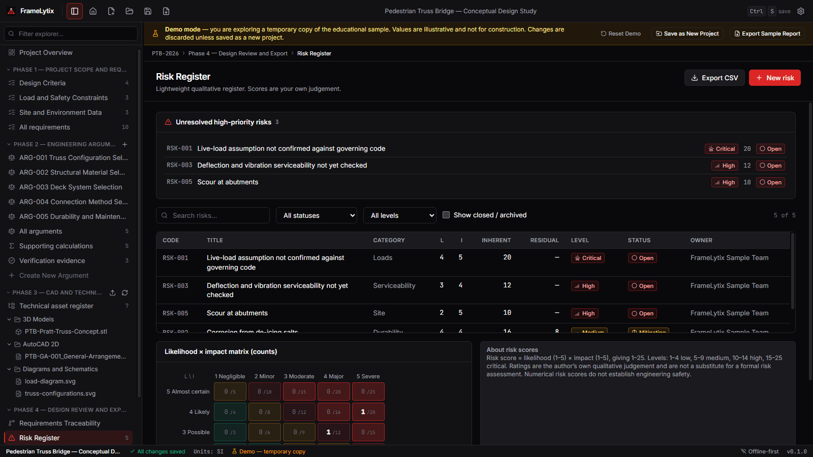

## 15. Reviewing the project

Two pages help you find gaps.

**Requirements Traceability** shows a matrix of requirements against arguments, calculations, drawings and evidence, plus two percentages:

- **Traceability coverage**: the share of active requirements (not archived, not Not Applicable) linked to at least one existing, non-archived argument, calculation, drawing/asset or evidence record.
- **Evidence coverage**: the share of active requirements linked to at least one evidence record *or* having verification notes.

These measure documentation links, not engineering validity. Use **Only gaps** and the classification filter to focus, and **Export CSV** to take the matrix to a spreadsheet.

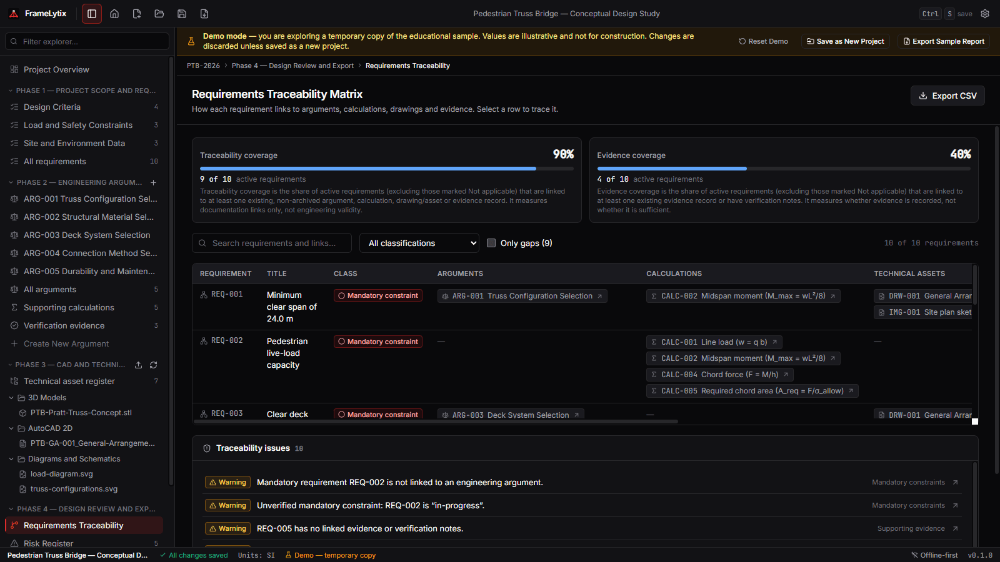

**Review Checklist** is a list of documentation checks in ten categories (scope, decisions, constraints, assumptions, calculations, evidence, drawings, risks, references, reporting). Mark each Open, Complete or Not applicable (with a reason). **Documentation completeness** is the number of Complete items divided by the applicable (not "Not applicable") items. It only measures the checklist; it does not mean the design is correct. The page also lists detected issues, graded critical, warning or info, and each one links to the place to fix it.

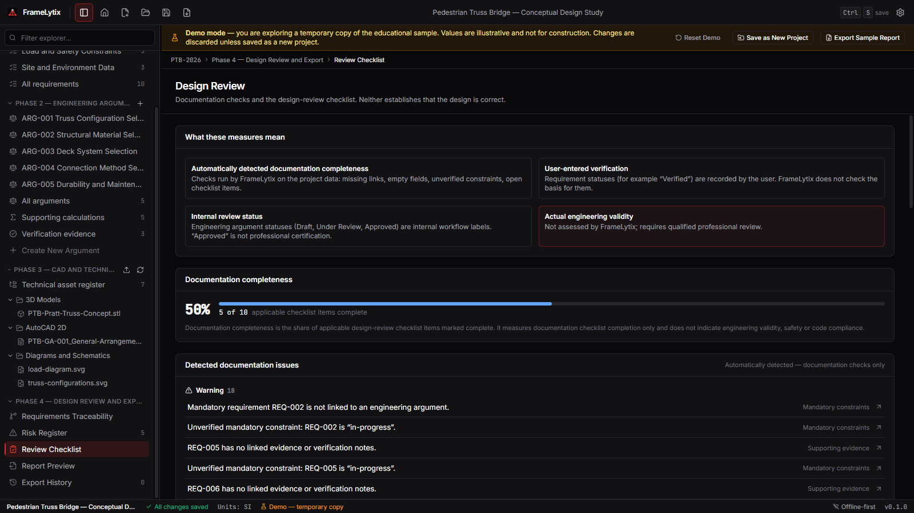

## 16. Exporting reports

Open **Report Preview** (or the toolbar's Export report button).

1. Tick the **Report sections** you want (16 are available, such as Cover page, Executive summary, Requirements, Engineering arguments, Calculations, Requirements traceability, Risk register, Revision history, Drawings and models, Design review, Outstanding items and Disclaimer and limitations). Your choice is saved with the project.
2. Check the live **Preview**; use Zoom if needed.
3. Select **Export PDF** or **Export HTML** and choose where to save. In a normal project the save dialog starts in `04-Design-Review-and-Export`. PNG, JPEG and SVG drawings are embedded as pictures (up to 40 images of 5 MB or less).
4. Under **CSV exports** you can also export Requirements, Traceability matrix, Risk register, or the Decision matrix of a chosen argument.

Incomplete projects can still be exported; unresolved gaps are listed in the "Outstanding items" section. Every report carries a disclaimer that it is a documentation package, not a certification of engineering adequacy. **Export History** lists what was exported (file names and dates, not paths).

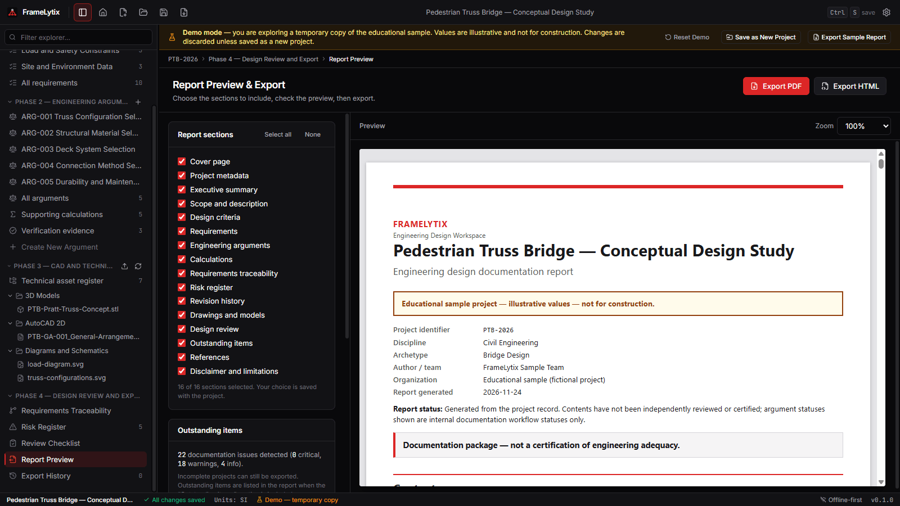

## 17. Saving and backups

- **Autosave** is on by default and saves shortly after you stop typing (the delay and the on/off switch are in **Settings**). **Save** (Ctrl+S) saves immediately.
- Saves are *atomic*: FrameLytix writes a temporary file and swaps it in, so a crash mid-save cannot leave a half-written project file.
- **Backups** of the project file are kept in `.framelytix/backups/`. A manual save makes a backup when something changed; autosave makes one at most every five minutes. FrameLytix keeps the newest 10 by default (Settings allows 3 to 50).
- If the project file is damaged, FrameLytix offers a **Project file is damaged** recovery dialog listing the backups. Select a valid one and **Restore selected backup**. The damaged file is first kept as `corrupted-<time>.json` in the backups folder, so nothing is lost.
- If you close the window with unsaved changes, FrameLytix asks what to do.

Backups protect against mistakes in the project file only. They are not a replacement for copying your whole project folder somewhere safe.

## 18. Moving a project to another computer

A project is just a folder. To move it:

1. Close the project in FrameLytix.
2. Copy or zip the whole project folder (you can leave out `.framelytix/`; it is recreated).
3. Copy it to the other computer, unzip if needed, and use **Open Existing Project** to select the folder (or its `framelytix-project.json`).

All file references inside the project are *relative* to the project folder, so nothing breaks when the folder is renamed or moved. Your recent-projects list and settings are per computer and do not travel with the project.

## 19. Using Git with a project (optional)

Git is not required. If you use it, put the project folder in a repository. FrameLytix can write a `.gitignore` for you when you create a project (the checkbox in the new-project wizard). For projects you already have, create the file yourself with the lines listed below. The generated file ignores `.framelytix/backups/`, `.framelytix/lock.json`, temporary files, and CAD autosave/lock files such as `*.dwl`, `*.dwl2` and `*.sv$`, but keeps the project file and your drawings tracked. FrameLytix does not create a Git repository for you.

## 20. Keyboard shortcuts

Use **Ctrl** on Windows (**Cmd** on macOS, which is untested).

| Shortcut | Action |
| --- | --- |
| Ctrl+N | New project |
| Ctrl+O | Open project |
| Ctrl+S | Save now |
| Ctrl+B | Show or hide the sidebar (ignored while typing in a text field) |
| Ctrl+F | Focus the explorer filter (ignored while typing in a text field) |

Viewers have their own keys, shown in their button tooltips (for example + and − to zoom, 0 to fit).

## 21. Troubleshooting

**Windows SmartScreen blocks the installer.** The installer is unsigned. Verify the SHA-256 checksum first ([section 1](#1-installing)). Only if it matches, choose More info, then Run anyway.

**"This project appears to be open in another FrameLytix window."** FrameLytix places a small lock file (`.framelytix/lock.json`) in an open project to stop two windows editing at once. Close the other window. If FrameLytix crashed, the lock on the same computer is detected as stale and cleared automatically. A lock from another computer blocks opening for up to 12 hours (for example if the project sits in a shared or synced folder); after that it is cleared automatically.

**"The project file was changed outside FrameLytix."** Something else (a sync tool, a text editor, Git) modified `framelytix-project.json` while the project was open. A banner offers **Reload from disk** (discard your unsaved changes, load the outside version) or **Keep my version (back up theirs)** (save yours; the outside version is saved in `.framelytix/backups` as `external-<time>.json`). Nothing is overwritten silently.

**"Project file is damaged".** Use the recovery dialog described in [section 17](#17-saving-and-backups). If no backups exist you will see an error message only; restore the file from your own copy.

**"No application is associated with .dwg files."** Windows has no program registered for that file type. Install a viewer or use Reveal in File Explorer ([section 12](#12-opening-native-cad-files)).

**"3D preview requires WebGL."** Your graphics driver or remote-desktop session does not provide WebGL. Update the graphics driver, or open the STL in another program.

**"This project uses schema version N, which is newer…"** The project was saved by a newer FrameLytix. Update FrameLytix. The file is not modified.

**A referenced file is missing.** A banner lists missing files after opening, and the asset register marks them. Restore the file in the project folder, or relink it with the file's page.

**An old `structura-project.json` project.** That early prototype format is not supported.

**Something else.** FrameLytix writes a small error log in its per-user app-data folder. Do not attach private project data when reporting a problem.
